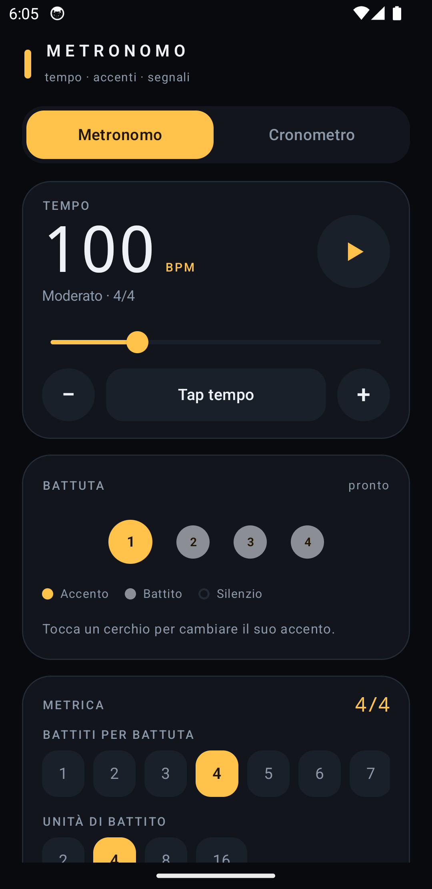
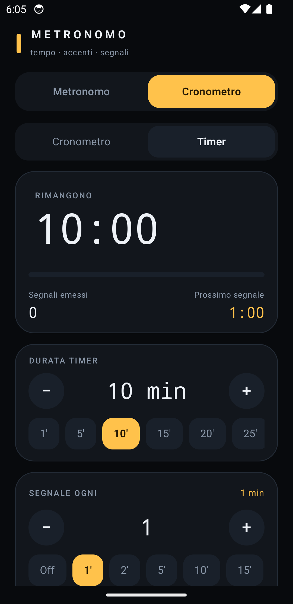

# Metronomo

App Android nativa (Kotlin + Jetpack Compose) con due strumenti in un'unica schermata:

1. **Metronomo musicale** — tempo, metrica, suddivisioni e accenti per ogni battito.
2. **Cronometro / Timer** — segnali acustici impostabili ogni *X* minuti, anche a schermo spento.

Interfaccia in italiano, tema scuro, nessun asset audio: tutti i suoni sono sintetizzati a runtime.

## Schermate

| Metronomo | Cronometro / Timer |
|---|---|
|  |  |

APK firmato: [Releases](https://github.com/muccio/metronomo/releases).

---

## 1. Metronomo

| Funzione | Dettagli |
|---|---|
| Tempo | 30–300 BPM, slider + step ±1, **tap tempo** (media degli ultimi 2,5 s) |
| Indicazione | Largo → Prestissimo |
| Metrica | 1–12 battiti per battuta, unità 2/4/8/16 |
| Suddivisione | ×1 … ×6 (duine, terzine, quartine, quintine, sestine) |
| Accenti | Per ogni battito: **accento**, **normale**, **silenzio** (tocca il cerchio) |
| Indicatore | Pallino attivo animato, sincronizzato con l'audio |
| Audio | Click sintetizzati (accento più acuto e forte, suddivisioni più leggere), mute |

**Precisione**: il click non è programmato con timer ma renderizzato in un `AudioTrack` in streaming
su un thread a priorità massima. Ogni evento è posizionato su un frame esatto (48 kHz), quindi il
tempo non deriva nemmeno dopo ore. Il buffer è di 512 frame (~10 ms), con `PERFORMANCE_MODE_LOW_LATENCY`.

## 2. Cronometro / Timer

| Funzione | Dettagli |
|---|---|
| Cronometro | Avvia / Pausa / Riprendi / Azzera, centesimi di secondo |
| Timer | Durata 1–600 min, conto alla rovescia con barra di avanzamento |
| Segnali | Campanello ogni **N minuti** (0 = off, 1–180), presets rapidi |
| Extra | Vibrazione, conteggio segnali emessi, countdown al prossimo segnale, flash visivo |
| Background | Foreground service + `PARTIAL_WAKE_LOCK`: i segnali arrivano anche a schermo spento o con l'app in background |

Il tempo trascorso è sempre calcolato da `SystemClock.elapsedRealtime()`: eventuali ritardi del
ticker non producono drift, e i segnali arretrati vengono recuperati tutti insieme.

---

## Build

Requisiti: JDK 17, Android SDK (compileSdk 34).

```bash
export JAVA_HOME=/Library/Java/JavaVirtualMachines/zulu-17.jdk/Contents/Home
./gradlew :app:assembleDebug
```

APK: `app/build/outputs/apk/debug/app-debug.apk`

Installazione su device/emulatore collegato:

```bash
adb install -r app/build/outputs/apk/debug/app-debug.apk
adb shell am start -n com.metronomo.app/.MainActivity
```

Release (R8 attivo, APK ~0,8 MB):

```bash
./gradlew :app:assembleRelease
```

APK: `app/build/outputs/apk/release/app-release.apk`

### Firma

La firma release è opzionale: se `keystore.properties` non esiste (clone pulito, CI) l'APK
viene prodotto non firmato. Per firmarlo creare una keystore e un `keystore.properties`
nella root del progetto (entrambi **ignorati da git**):

```properties
storeFile=.keystore/metronomo-release.jks
storePassword=...
keyAlias=metronomo
keyPassword=...
```

```bash
keytool -genkeypair -keystore .keystore/metronomo-release.jks -alias metronomo \
  -keyalg RSA -keysize 4096 -validity 10950
```

## Struttura

```
app/src/main/java/com/metronomo/app/
├── MainActivity.kt              # entry point, edge-to-edge, permesso notifiche
├── MetronomoApp.kt              # Application: singleton dei due engine
├── audio/
│   ├── MetronomeEngine.kt       # motore audio campione-accurato (AudioTrack streaming)
│   ├── ChronometerEngine.kt     # cronometro/timer, ticker, segnali, vibrazione
│   ├── ClickSynth.kt            # sintesi dei click e dei campanelli
│   └── ChimePlayer.kt           # WAV generati in cache + SoundPool
├── service/
│   └── TimerService.kt          # foreground service + notifica con Pausa/Azzera
└── ui/
    ├── MetronomoRoot.kt         # header e tab
    ├── MetronomeScreen.kt       # UI metronomo
    ├── ChronometerScreen.kt     # UI cronometro/timer
    ├── Components.kt            # card, chip, stepper, trasporto
    └── theme/Theme.kt           # palette e tipografia
```

## Permessi

- `FOREGROUND_SERVICE` / `FOREGROUND_SERVICE_SPECIAL_USE` — cronometro attivo in background
- `WAKE_LOCK` — mantenere la CPU attiva per i segnali a schermo spento
- `POST_NOTIFICATIONS` — notifica del cronometro (Android 13+)
- `VIBRATE` — vibrazione opzionale

## Note

- Le impostazioni (BPM, metrica, accenti, intervallo, durata, toggle audio/vibrazione) sono
  persistite in `SharedPreferences` e ripristinate al riavvio.
- Il metronomo continua a suonare se l'app va in background; si ferma chiudendo l'app.
